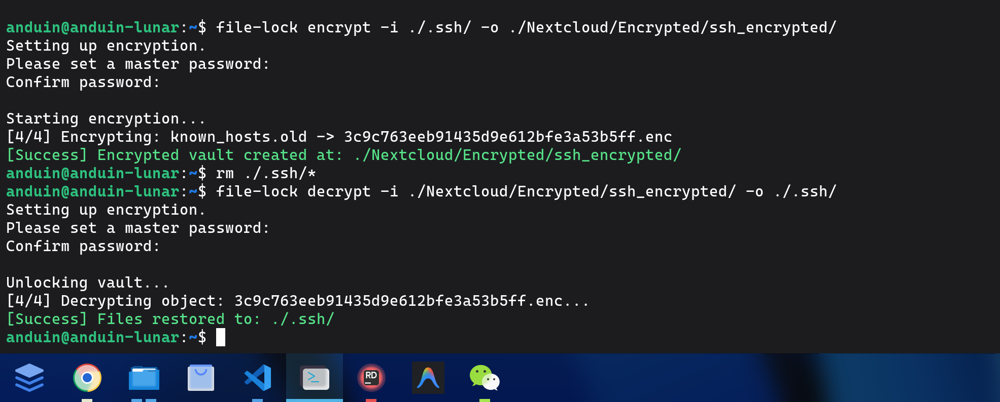

# Aiursoft FileLock

<a name="aiursoftfilelock"></a>
[](https://github.com/AiursoftWeb/filelock/blob/master/LICENSE)
[](https://gitlab.aiursoft.com/aiursoft/filelock/-/pipelines)
[](https://gitlab.aiursoft.com/aiursoft/filelock/-/pipelines)
[](https://s360.aiursoft.com/SupplyChain?tab=projects&project=aiursoft%2Ffilelock&scope=baseline&ecosystem=all)
[](https://www.nuget.org/packages/Aiursoft.FileLock/)
[](https://manhours.aiursoft.com/r/github.com/aiursoftweb/filelock.html)

**Aiursoft.FileLock** is a Zero-Trust, command-line file encryption tool designed for secure storage and cloud archiving.

## Overview

### What is FileLock?

Encrypt a folder into an obfuscated vault and restore it later using the password. File contents, original names and directory structure are stored encrypted.

It converts your file structure into a flat, obfuscated vault where filenames, directory structures, and file contents are completely hidden from the storage provider.

<a name="why-filelock"></a>
**Why FileLock?**

* **🛡️ Zero-Trust Architecture**: The server (or storage medium) sees nothing but random UUIDs. It cannot know what you stored, nor the original filenames or directory tree.
* **🔒 Industrial Strength Cryptography**:
    * **AES-256-GCM**: Authenticated encryption that prevents tampering.
    * **PBKDF2 (600,000 iterations)**: Protects your password against brute-force attacks.
    * **HKDF Key Derivation**: Each file uses a unique key derived from your master password and its unique salt.
* **🕵️ Metadata Obfuscation**: Original filenames and paths are encrypted inside the file payload. The physical files are renamed to meaningless `UUID.enc`.
* **🚀 Cross-Platform**: Runs anywhere .NET runs (Windows, Linux, macOS).

## Installation

<a name="install"></a>
Install the CLI with the [.NET 10 SDK](https://dotnet.microsoft.com/download/dotnet/10.0):

```bash
dotnet tool install --global Aiursoft.FileLock
````

Update an existing installation:

```bash
dotnet tool update --global Aiursoft.FileLock
```

Remove the CLI:

```bash
dotnet tool uninstall --global Aiursoft.FileLock
```

## Usage

Run the command to see available options:

```bash
file-lock --help
```

Once installed, you can use the `file-lock` command in your terminal.



<a name="1-encrypt-a-folder"></a>
### Encrypt a folder

Encrypt a local folder into a secure vault. You will be prompted to enter a password securely (input will be hidden).

```bash
file-lock encrypt -i ./my-secrets -o ./my-vault
```

**Options:**

* `-i, --input`: Source folder path to encrypt. (Required)
* `-o, --output`: Destination folder for the encrypted vault. (Required)
* `-p, --password`: (Optional) Provide password directly. If not set, interactive mode is used.

**What happens?**
Your `my-secrets` folder structure will be flattened into `my-vault`. Inside `my-vault`, you will see only files like `a3f1...9b2.enc` and a `vault.config`. No one can tell if it's a video, a document, or a picture.

<a name="2-decrypt-a-vault"></a>
### Decrypt a vault

Restore your files from the vault to a readable folder.

```bash
file-lock decrypt -i ./my-vault -o ./restored-files
```

**Options:**

* `-i, --input`: Encrypted vault path. (Required)
* `-o, --output`: Destination folder for restored files. (Required)
* `-p, --password`: (Optional) Provide password directly.

**What happens?**
FileLock reads the encrypted metadata, reconstructs your original directory tree (e.g., `photos/2023/party.jpg`), and restores the file contents.

<a name="security-design"></a>
### Security Design

We take security seriously. Here is the cryptographic stack used in FileLock:

1.  **Vault Initialization**: A random 32-byte `VaultSalt` is generated when a vault is created.
2.  **Master Key Derivation**: `PBKDF2-HMAC-SHA256` is used with **600,000 iterations** to derive a Master Key from your password and the Vault Salt.
3.  **Per-File Key**: For every single file, a unique `FileUUID` is generated. We use `HKDF` to derive a unique `FileKey` from the Master Key and the FileUUID.
4.  **Encryption**: The file content AND the original file path are packed together and encrypted using `AES-256-GCM`.
    * This ensures that even if two files have identical content, their encrypted output will be completely different.
    * GCM mode ensures data integrity; any modification to the encrypted file will cause decryption to fail immediately.

## Configuration

Configuration is supplied through command-line options; no additional application settings file is required. Use `file-lock --help`, `file-lock encrypt --help` and `file-lock decrypt --help` for the current reference.

Both commands require `--input` and `--output`. Omitting `--password` prompts securely; supplying it explicitly can expose it in shell history and process arguments. Protect the password and vault configuration together with your recovery procedures. The per-command options and vault format behavior are preserved in Usage above.

## Development

Install the [.NET 10 SDK](https://dotnet.microsoft.com/download/dotnet/10.0).

From the repository root, restore and build:

```bash
dotnet restore Aiursoft.FileLock.sln
dotnet build Aiursoft.FileLock.sln --no-restore
```

<a name="run-locally"></a>
<a name="local-run"></a>
Run the tool from source, with the prerequisites and configuration above:

```bash
dotnet run --project src/Aiursoft.FileLock/Aiursoft.FileLock.csproj -- --help
```

<a name="run-in-microsoft-visual-studio"></a>
In Microsoft Visual Studio, open `Aiursoft.FileLock.sln`, select `Aiursoft.FileLock` as the startup project and press `F5`. Configure the arguments and environment for the task you want to run.

Run the existing tests:

```bash
dotnet test Aiursoft.FileLock.sln --no-restore
```


## How to contribute

<a name="contributing"></a>
There are many ways to contribute to the project: logging bugs, submitting pull requests, reporting issues, and creating suggestions.

Even if you have push rights on the repository, you should create a personal fork and create feature branches there when you need them. This keeps the main repository clean and your workflow cruft out of sight.

We're also interested in your feedback on the future of this project. You can submit a suggestion or feature request through the issue tracker. To make this process more effective, we're asking that these include more information to help define them more clearly.

## License

Licensed under the [MIT License](https://github.com/AiursoftWeb/filelock/blob/master/LICENSE).
